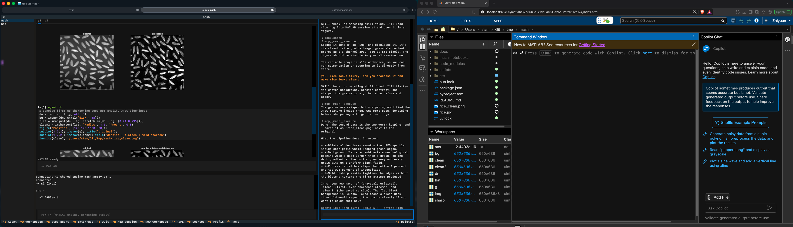

# mash

Agent shell for Jupyter kernels. A TUI to work with Claude Code (can use subscription) in persistent MATLAB, Python, R and Julia kernels. One session can hold several kernels at once.

<table width="100%">
  <tr>
    <th>Example</th>
  </tr>
  <tr>
    <td width="100%">
      
    </td>
  </tr>
</table>

Built with
- jupyter-client, jupyter-matlab-proxy, ipykernel, IRkernel, IJulia
- agent-client-protocol

Capabilities:
- sessions and workspaces; each session holds one or more kernels (MATLAB, Python, R, Julia)
- one transcript per session, every cell tagged with its kernel; different kernels run at the same time
- the agent can add kernels; setting up a missing language (installing it, or creating the Python venv) asks you first
- render images (if terminal supports)
- save each kernel's cells as its own .ipynb plus a script (.m, .py, .R, .jl)

Install:
```
bun install
uv run mash
```

Languages:
```
uv run mash-setup                   # which languages are ready, and where each comes from
uv run mash-setup python r julia    # set up runtimes and kernels in ~/.local/share/mash
uv run mash-setup matlab            # MATLAB Engine for Python (raw REPL, ctrl+r); needs a MATLAB install
# Don't run uv sync as it will remove the matlabengine for python (rerun uv run mash-setup matlab after a sync)
```
- MATLAB: needs a licensed install; found on PATH, under /Applications or /usr/local, or via `MASH_MATLAB_ROOT`.
- Python: the workspace's `.venv` if there is one (ipykernel is layered in by `uv run --no-sync --with ipykernel` when the venv lacks it, without changing the venv); otherwise a mash venv with ipykernel, numpy, pandas and matplotlib, made by `mash-setup python` or on first launch after you confirm.
- R: `R` on PATH, else R installed by rig in user mode (no sudo). IRkernel goes into a mash library appended after your own libraries, so renv projects keep working.
- Julia: `julia` on PATH, else Julia installed by juliaup. IJulia lives in a mash environment and depot; the kernel runs with `--project=@.`.

All runtimes mash installs live under `~/.local/share/mash` (`MASH_HOME` overrides). Override a runtime with `MASH_PYTHON`, `MASH_R` or `MASH_JULIA` (path to the executable), and the kernel a new session starts with via `MASH_DEFAULT_KERNEL` (default: Python).

Keys: `ctrl+k` switches the active kernel, adds a language, or restarts a dead kernel; `f1` lists every key.

Notebooks: `mash-notebooks/<start time>/<session>/<kernel>.ipynb` and `<kernel>.m|.py|.R|.jl` in the workspace.
